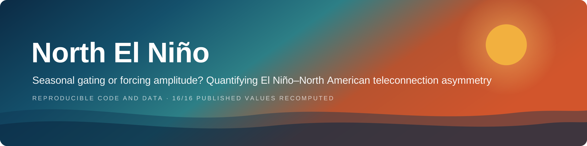
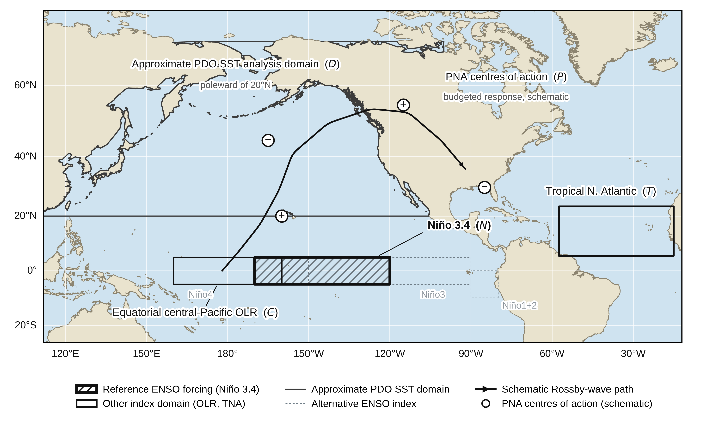

<p align="center">
  
</p>

<p align="center">
  
  
  
  
  
  
</p>

Analysis code for *Seasonal gating or forcing amplitude? Quantifying El Niño–North
American teleconnection asymmetry* (Razavi & Bonakdari).

When El Niño warms the tropical Pacific, why does its grip on North American
weather tighten so late in the season, and loosen so quickly the following
spring? This repository answers that with a **tendency budget of the PNA index**,
partitioned against a season-invariant null model to separate the part of the
development–decay asymmetry that follows from forcing *amplitude* from the part
that follows from seasonally varying atmospheric *coupling*.

Everything in the paper is reproduced from the thirteen monthly index files in
`data/`. No gridded fields, no downloads, no network access.

## Analysis domains

<p align="center">
  
</p>

<sub>Geographic domains of the indices entering the PNA tendency budget (Niño 3.4,
hatched; central-Pacific OLR; tropical North Atlantic), the approximate PDO SST
analysis domain poleward of 20°N, and the alternative ENSO indices used only for
robustness. The wave path and PNA centres of action are schematic. Vector source:
<a href="assets/fig01_domains.svg">fig01_domains.svg</a>.</sub>

## Quick start

```bash
python -m venv .venv && source .venv/bin/activate   # Windows: .venv\Scripts\activate
pip install -r requirements.txt

python run_all.py          # every figure and table  (~26 s)
python verify_numbers.py   # assert the values quoted in the paper
```

Selected items only:

```bash
python run_all.py fig01 fig05 table07_interaction
```

## Does it still reproduce?

`verify_numbers.py` recomputes sixteen headline quantities straight from the
index files and compares each with the number printed in the paper:

```
PASS  AsyI tendency              computed -1.0357   published -1.0400
PASS  AsyI 95% CI                computed +0.4995   published +0.5000
PASS  AsyI p-value               computed +0.0011   published +0.0010
PASS  events with negative AsyI  computed +9.0000   published +9.0000
...
All checks passed.
```

It exits non-zero on a mismatch, so it drops straight into CI.

## Layout

```
enso_na/            analysis package
  config.py           analysis period, reference window, key phases, styling
  data.py             index loading, monthly aggregation, smoothing
  events.py           El Niño identification, life cycles, composites
  budget.py           design matrix, budget fit, AsyI / AAE / WTI, decompositions
  plotting.py         shared figure style
figures/            one script per figure (fig01-fig07, figS01-figS05)
tables/             table07_interaction.py  (Eq. 8 seasonal interaction test)
data/               thirteen NOAA climate indices, NetCDF
assets/             README banner and the domain map
outputs/            CSV tables written by the scripts
verify_numbers.py   regression test against the published values
```

Figures and tables are regenerated, not tracked; `.gitignore` excludes them.

## Method in one paragraph

The monthly tendency of the standardized PNA index is regressed on an effective
internal damping term and eight predictors, with coefficients allowed an annual
harmonic and fitted over the whole record without conditioning on El Niño
events. Tendencies use a **forward** difference: with a centred difference the
damping coefficient is unidentifiable, because the lag +1 and lag −1
autocovariances cancel. The budget is integrated over August–October of the
development year (ASO0) and February–April of the decay year (FMA1); their sum
is the asymmetry index, AsyI. The smoothing window *k* is an explicit free
parameter, scanned from 1 to 7 months, with *k* = 2 selected by a prespecified
closure criterion.

## Data

| Index | File | Source |
|---|---|---|
| PNA | `pna.nc` | NOAA CPC |
| Niño3.4, Niño3, Niño4, Niño1+2 | `nino*.nc` | NOAA CPC / OISST, base period 1991–2020 |
| OLR El Niño Index | `olren.nc` | NOAA, Chiodi & Harrison index |
| OLR La Niña Index | `olrln.nc` | NOAA (not used in the reference budget) |
| PDO | `pdo.nc` | UW/JISAO (Mantua et al. 1997) |
| TNA | `tna.nc` | NOAA PSL, 5.5°–23.5°N, 57.5°–15°W |
| AO, NAO | `ao.nc`, `nao.nc` | NOAA CPC |
| SOI | `soi.nc` | NOAA CPC |
| AMO | `amo.nc` | NOAA PSL (robustness only) |

Common analysis period: January 1982 – July 2026.

> **Known caveat.** `olren.nc` carries the long name *OLR El Niño Index* and comes
> from the Chiodi & Harrison daily product, not the CPC central-Pacific OLR index
> (5°S–5°N, 160°E–160°W). The two cover different regions. Confirm the exact
> domain against Chiodi & Harrison (2010, *J. Climate*, **23**, 2428–2439) before
> relying on the regional description in the paper or in the map above.

## Figures

`plotting.save()` writes both PNG and PDF. **Submit the PDF**: it is vector, and
the PNG at `FIG_DPI = 300` falls below the resolution most journals require for
raster artwork.

## Citation

See `CITATION.cff`.

## License

MIT, see `LICENSE`. The index files are public-domain NOAA products.
