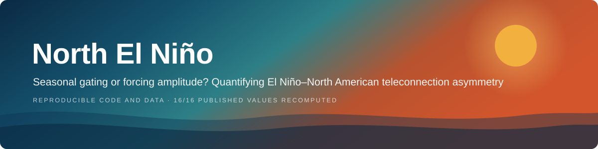

<p align="center">
  
</p>

<p align="center">
  <a href="https://github.com/HoomanAI/north-el-nino/actions/workflows/reproduce.yml"></a>
  
  <a href="LICENSE"></a>
  
  
</p>

<p align="center">
  
  
  
  
  
</p>

This repository holds everything you need to rebuild the figures and numbers of
the paper *Why El Niño's North American teleconnection engages late and collapses
early*. The paper asks a simple question: when El Niño warms the tropical Pacific,
why does its grip on North American weather (the Pacific/North American pattern,
or PNA) switch on so late in the year, and why does it fade so quickly the
following spring? It answers that with a tendency budget of the PNA index, viewed
through integration windows of one to seven months.

> [!TIP]
> **Just want the figures?** Install the requirements and run one command.
> Everything comes from the thirteen small index files in `data/`, and nothing is downloaded.
>
> ```bash
> pip install -r requirements.txt
> python run_all.py
> ```

> [!NOTE]
> **This is a verified copy.** Every number in the manuscript was checked against
> what this code actually produces. The data, the method and the results are exactly
> those of the original package, and all 15 output tables match it byte for byte.
> The only code changes tidy up how a few figures are drawn (an overlapping label,
> a clipped bar, a legend sitting on top of the data). Each one is marked
> `# VERIFY (display only)`, and [`VERIFICATION.md`](VERIFICATION.md) lists them all.

## Getting started

```bash
pip install -r requirements.txt
python run_all.py                         # all figures and tables, about 25 seconds
python run_all.py fig03                   # just one figure
python verification/verify_claims.py      # re-check the 58 statements in the paper
```

Figures land in `figures/` as `figXX_verified.png` and `.pdf`, and every number
quoted in the paper is written to `outputs/` as a CSV file. If you prefer the
original file names, set `ENSO_NA_SUFFIX=` (empty). You can also point the input
and output somewhere else with `ENSO_NA_DATA`, `ENSO_NA_FIGDIR` and `ENSO_NA_OUTDIR`.

Every figure script also runs on its own, for example `python figures/fig04.py`,
as long as the repository root is on your `PYTHONPATH`. `run_all.py` takes care of that for you.

## What is inside

```
data/                     the 13 index files (NetCDF) that feed everything
enso_na/
  config.py               paths, analysis constants and term labels
  data.py                 reads the files and puts them all on one monthly axis
  events.py               finds the El Niño events, builds composites, runs the statistics
  budget.py               the tendency budget and the AsyI, AAE and WTI diagnostics
  plotting.py             the shared figure style
figures/fig01..07.py      main figures (each also writes the CSV tables it uses)
figures/figS01..05.py     supplementary figures
run_all.py                rebuilds everything in one go
download_gridded.py       optional extra: gridded maps over North America
verification/
  verify_claims.py        checks the manuscript's numbers against the code output
  verification_checks.csv the reference result for all 58 checks
```

## The data

The index files come at four different sampling rates (weekly, daily, monthly and
annual) and use several names for their time axis. `data.py` irons this out and
turns everything into one table of monthly means. A month only counts if a weekly
series has at least 2 values in it, or a daily series at least 15; otherwise it is
left blank.

| File | What it is | Sampling | Record | Where it comes from |
|---|---|---|---|---|
| `nino12.nc`, `nino3.nc`, `nino34.nc`, `nino4.nc` | Niño SST anomalies | weekly | 1981-09 to 2026-08 | [NOAA CPC weekly ENSO indices (OISSTv2)](https://www.cpc.ncep.noaa.gov/data/indices/wksst8110.for) |
| `tna.nc` | Tropical North Atlantic index | weekly | 1981-09 to 2026-08 | [NOAA PSL](https://psl.noaa.gov/gcos_wgsp/Timeseries/TNA/) |
| `olren.nc` | OLR anomaly over the equatorial central Pacific | daily | 1982-01 to 2026-09-04 (usable to 2026-08) | [NOAA interpolated OLR](https://psl.noaa.gov/data/gridded/data.olrcdr.interp.html) |
| `olrln.nc` | yearly count of suppressed-convection days | annual | 1982 to 2026 | built from the same daily OLR record |
| `pna.nc`, `nao.nc`, `ao.nc` | teleconnection indices | monthly | 1950-01 to 2026-08 | [NOAA CPC](https://www.cpc.ncep.noaa.gov/data/teledoc/telecontents.shtml) |
| `pdo.nc` | Pacific Decadal Oscillation | monthly | 1854-01 to 2026-07 | [NOAA NCEI](https://www.ncei.noaa.gov/access/monitoring/pdo/) |
| `soi.nc` | Southern Oscillation Index | monthly | 1951-01 to 2026-07 | [NOAA CPC](https://www.cpc.ncep.noaa.gov/data/indices/soi) |
| `amo.nc` | Atlantic Multidecadal Oscillation | monthly | 1948-01 to 2023-01 | [NOAA PSL](https://psl.noaa.gov/data/timeseries/AMO/) |

Two of these files stay out of the main budget. `olrln.nc` is a yearly count, and
`amo.nc` stops in January 2023, before the decay year of the 2023/24 event, so it
is only used when loading the extended record.

<details>
<summary><b>Optional: gridded maps over North America</b></summary>

<br>

`download_gridded.py` adds composite maps of 500 hPa height, surface air
temperature and precipitation over North America. It downloads about 700 MB from
NOAA PSL, and none of the paper's figures need it. The download links are listed
at the top of the script. NOAA PSL moves its folders around from time to time, so
if a download fails, look up the current path at <https://psl.noaa.gov/data/gridded/>.

</details>

## How the analysis works

**Picking the events.** A winter counts as El Niño when the December to February
mean of the 3-month running Niño3.4 anomaly is above 0.5 °C. The winters of
1986/87 and 2014/15 are left out, because in both cases the warmth carried
straight on into the next event. That leaves ten events between 1982/83 and 2023/24.

**The budget.** The month-to-month change of the standardised PNA index is written as

```
dP/dt = -λ(t)·P + a_N(t)·N + a_C(t)·C + a_Ṅ(t)·dN/dt + a_D(t)·D
        + a_T(t)·T + a_A(t)·A + a_M(t)·M + a_L(t)·NL + R
```

Here N is Niño3.4, C is OLR, D is the PDO, T is the TNA index, A is the AO, M is
the NAO, and NL is a nonlinear ENSO term made independent of N. Each coefficient
is allowed an annual cycle, and the whole thing is fitted by ordinary least
squares over every month of the record, so nothing about the asymmetry being
studied is built into the fit. All terms are in PNA standard deviations per month.

Two choices matter most. First, `dP/dt` is a **forward** difference. For a
first-order autoregressive process a centred difference is exactly uncorrelated
with the current state, so it could never pick up a damping term. Second, the one
free setting is the **integration window** k (1 to 7 months) over which every
field is smoothed. Think of it as the time-domain version of the mixed-layer
depth used in ocean heat budgets, which this framework borrows from.

**Reading the results.** Three diagnostics summarise each term: AsyI (its net
contribution over the key development and decay periods), AAE (how consistently
it points one way, between -1 and +1) and WTI (how much it changes with the
window). The key periods, August to October of the development year (ASO0) and
February to April of the decay year (FMA1), are fixed in `enso_na/config.py`. The
reference window of k = 2 comes from a written rule in
`budget.select_reference_window` rather than being picked by hand.

**Uncertainty.** The 95% confidence intervals are Student-t intervals across the
ten events. To see how much the answer depends on the choice of ENSO index,
everything is repeated with five versions (Niño1+2, Niño3, Niño3.4, Niño4 and the
inverted SOI). They play the part that a multi-reanalysis ensemble plays in ocean
heat budget studies.

## Things to keep in mind

> [!IMPORTANT]
> **Ten events is not many.** The composite tendency asymmetry is significant
> (p = 0.001) and shows up in 9 of the 10 events, but comparisons of speed for
> single events are not significant, and several of the smaller budget terms flip
> sign depending on which ENSO index is used.

- **The integration scheme matters for the total.** The sign of the *total*
  tendency asymmetry depends on how the phases are integrated (Fig. S5). Over a
  full phase the tendency adds up to just the difference between the end values,
  and that is dominated by the La Niña-like negative PNA early in the development
  year. The key-period comparison uses two windows of equal length at matching
  times of year, so it avoids this problem.
- **This is a statistical budget.** It tells you which covariates account for the
  asymmetry, not what causes it, and the leftover residual is sizeable during decay.

> [!WARNING]
> **Two statements are still unverified.** The paper cites Song et al. (2026),
> ref. 15, for two points: that about 91% of the oceanic asymmetry comes from
> amplitude, and that the same key periods show up in the oceanic heat budget.
> Neither can be checked with this code and data, and only the abstract of that
> article could be accessed, so both remain open.

## License

The code is shared under the [MIT License](LICENSE), so feel free to use and adapt
it. The index files in `data/` are derived from public NOAA products; if you reuse
them, please cite the original sources listed above.
